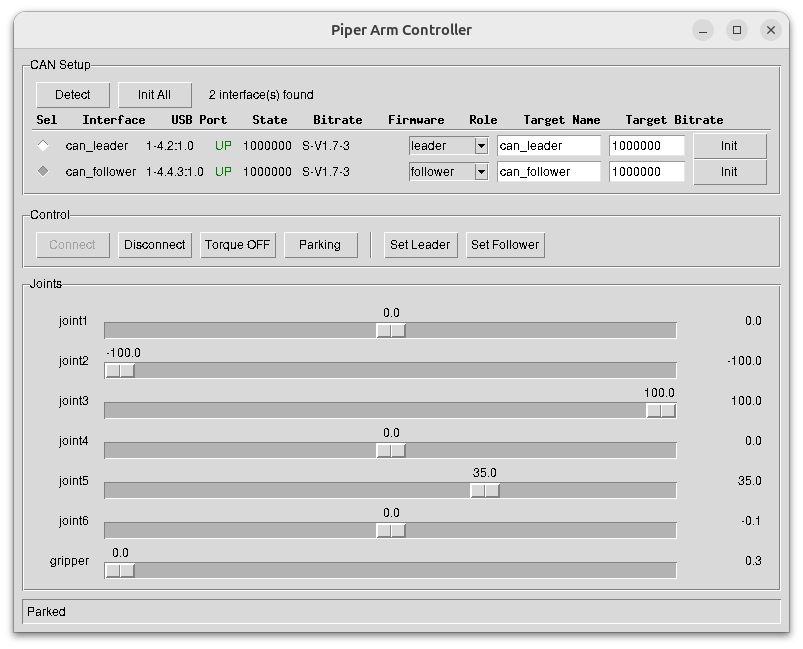
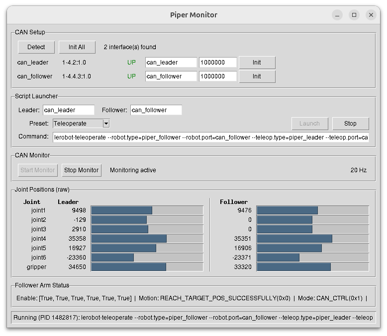
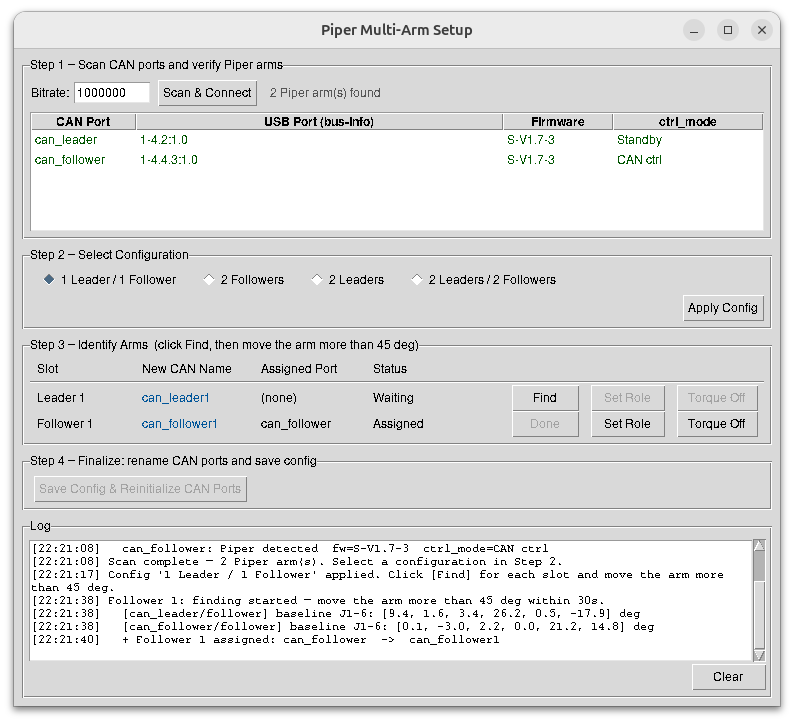

# lerobot_robot_piper

[](https://github.com/WeGo-Robotics/lerobot_robot_piper/releases)
[](https://www.apache.org/licenses/LICENSE-2.0)


LeRobot plugin for the **Agilex Piper** 7-DOF robotic arm. Provides follower (robot) and leader (teleoperator) interfaces that integrate directly with the [LeRobot](https://github.com/huggingface/lerobot) framework for teleoperation, dataset recording, and autonomous policy deployment.

```bash
# The whole setup, start to finish:
git clone https://github.com/WeGo-Robotics/lerobot_robot_piper.git
cd lerobot_robot_piper && pip install -e .
piper-doctor                                  # verify install & hardware
piper-setup                                   # name your arms (once)
sudo bash scripts/install_can_persist.sh      # survive reboots (once)
piper-teleop                                  # go
```

---

## Features

- **Leader-Follower Teleoperation**: Mirror a leader arm's movements onto a follower arm in real time
- **Dataset Recording**: Collect episodes (joint positions + camera frames) for imitation learning
- **CAN Bus Communication**: Direct hardware control via `piper_sdk`
- **Safety Limits**: Configurable `max_relative_target` to cap per-step joint movement
- **Camera Integration**: Attach multiple USB cameras as observations on the follower
- **GUI Tools**: Tkinter-based UIs for setup (`piper-setup`), direct control (`piper-ui`), teleoperation monitoring (`piper-teleop`), and zero-point calibration (`piper-calibrate`)
- **Boot-persistent CAN setup**: One-time install script keeps canonical CAN names across reboots and hotplugs

---

## Installation

**From PyPI**:

```bash
pip install lerobot_robot_wego_piper
```

> The PyPI name is `lerobot_robot_wego_piper` — the package named `lerobot_robot_piper` on PyPI is an **unrelated third-party project**. The import name stays `lerobot_robot_piper` either way.

**From source** — needed for the `scripts/` (CAN persistence) and development:

```bash
git clone https://github.com/WeGo-Robotics/lerobot_robot_piper.git
cd lerobot_robot_piper
pip install -e .
```

Wheels are also attached to each [GitHub Release](https://github.com/WeGo-Robotics/lerobot_robot_piper/releases). All dependencies, including [`piper_sdk`](https://pypi.org/project/piper_sdk/), resolve automatically from PyPI.

Verify the installation (and later, the hardware) with:

```bash
piper-doctor
```

**Requirements**: Python >= 3.10, LeRobot >= 0.3.0, Linux with SocketCAN (`iproute2`, `ethtool`, `can-utils`), CAN-USB interface (gs_usb) connected to the Piper arm.

```bash
sudo apt update && sudo apt install iproute2 ethtool can-utils
```

---

## Hardware Setup

### First-time setup (recommended path)

```bash
# 1. Assign canonical names to your arms (GUI wizard, see below)
piper-setup

# 2. Make the CAN setup persistent across reboots, hotplugs, and port swaps
#    (keep the arms plugged in — adapter serials are read live)
sudo bash scripts/install_can_persist.sh
```

After this, `can_leader1`, `can_follower1`, … come back up automatically on every boot and every re-plug.

**Why serial pinning matters**: plain `can0`/`can1` are kernel enumeration order — swap two adapters between USB ports and the arms silently swap names, so a leader can receive follower commands. The installer generates udev rules pinned to each adapter's USB **serial**, so the name follows the arm no matter which port it's plugged into. Re-run `piper-setup` + the installer only when an arm is rewired to a different adapter.

To see which adapter is which (e.g. before rewiring):

```bash
python3 scripts/list_can_adapters.py          # serial <-> interface table
python3 scripts/list_can_adapters.py --watch  # move an arm by hand to identify it
```

### `piper-doctor` — When something doesn't work

```bash
piper-doctor
```

Checks the whole chain in dependency order and prints a fix for every failure:

1. Python packages & LeRobot plugin registration (`piper_follower` / `piper_leader` types)
2. CAN adapter hardware on the USB bus
3. CAN interface state vs `~/piper_config.json` (names, UP, bitrate)
4. Arm response — passive RX counters, then an active firmware query
5. Boot persistence (udev rules + `piper-can-up.service`)

Read-only — never changes interface state or sends arm commands. Exit code 0 = healthy, 1 = problems found.

### Manual CAN activation (single arm, no wizard)

```bash
# Activate the only plugged-in CAN module as can0 at 1 Mbps
bash scripts/can_activate.sh can0 1000000

# Multiple modules plugged in: disambiguate by USB address
sudo ethtool -i can0 | grep bus-info
bash scripts/can_activate.sh can0 1000000 1-2:1.0
```

Or fully by hand:

```bash
sudo ip link set can0 type can bitrate 1000000
sudo ip link set can0 up
```

The `piper-ui` and `piper-teleop` GUIs can also detect and initialize CAN interfaces.

### Scripts

| Script | Purpose |
|--------|---------|
| `scripts/can_activate.sh` | Activate a single CAN interface (name, bitrate, optional USB address) |
| `scripts/can_restore.sh` | Bring up all arms from `~/piper_config.json` (rename if needed, bitrate, link up) |
| `scripts/install_can_persist.sh` | Generate serial-pinned udev `NAME=` rules + install boot/hotplug bring-up service; `uninstall` to remove |
| `scripts/list_can_adapters.py` | Show adapter serial ↔ interface table; `--watch` identifies an arm by moving it |

### Wiring

| Arm | Interface |
|-----|-----------|
| Follower (robot) | e.g., `can_follower1` (or `can0`) |
| Leader (human input) | e.g., `can_leader1` (or `can1`) |

---

## GUI Tools





### `piper-setup` — Multi-Arm Setup Wizard

Run this first when setting up multiple arms.

```bash
piper-setup
```

4-step wizard for configuring up to 4 arms:

1. **Scan** — detect all CAN ports, initialize, connect, and read firmware version from each arm
2. **Config** — select arm configuration (1 Leader/1 Follower, 2 Followers, 2 Leaders, 2 Leaders/2 Followers)
3. **Identify** — click `Find` for each slot, then physically move the target arm more than 45° to assign it; use `Set Role` to apply leader/follower mode and `Torque Off` to release the arm
4. **Finalize** — rename CAN ports to canonical names (`can_leader1`, `can_follower1`, etc.) and save `~/piper_config.json`

### `piper-ui` — Direct Control

```bash
piper-ui
```

- **CAN Setup**: detect interfaces, view firmware version and USB port per interface, select role (leader/follower), initialize bitrate
- **Connect**: select a port via radio button, then click Connect — sliders automatically sync to the arm's current joint positions
- **Torque**: toggle torque on/off; sliders and Parking are disabled while torque is off
- **Set Leader / Set Follower**: apply `MasterSlaveConfig` to switch the arm between teaching input mode and motion output mode
- **Parking**: move the arm to the home position (joint values: 0, −100, 100, 0, 35, 0, 0)
- **Joints**: drag sliders to move joints in real time (only active when torque is on); live position readout next to each slider

### `piper-teleop` — Teleoperation Monitor

```bash
piper-teleop
```

- Detect and initialize CAN interfaces
- Launch pre-configured teleoperation/recording commands
- Real-time joint position bars for both arms (leader & follower)
- Follower arm status (enable state, motion status, error codes)

### `piper-calibrate` — Joint Zero-Point Calibration

```bash
piper-calibrate
```

1. Connect to a Piper arm via CAN
2. Manually move each joint to its zero (home) position
3. Click **Set Zero** — writes the zero-point to the motor's flash (persists across power cycles)
4. Real-time joint monitor shows raw positions for verification

### `camera_check.py` — Camera Grid Viewer

```bash
python camera_check.py
```

Probes `/dev/video0` … `/dev/video17`, opens every working camera, and shows all streams in one grid — useful for finding camera indices before recording.

---

## Quick Start

### 1. Python API

```python
from lerobot_robot_piper import PiperFollowerConfig, PiperLeaderConfig, PiperFollower, PiperLeader

follower_cfg = PiperFollowerConfig(port="can_follower1")
leader_cfg   = PiperLeaderConfig(port="can_leader1")

follower = PiperFollower(follower_cfg)
leader   = PiperLeader(leader_cfg)

follower.connect()
leader.connect()

try:
    while True:
        action = leader.get_action()        # read leader joint positions
        follower.send_action(action)        # mirror to follower
        obs = follower.get_observation()    # read follower state + cameras
finally:
    follower.disconnect()
    leader.disconnect()
```

### 2. LeRobot CLI

```bash
# Teleoperate
python -m lerobot.teleoperate \
    --robot.type=piper_follower \
    --robot.port=can_follower1 \
    --teleop.type=piper_leader \
    --teleop.port=can_leader1

# Record a dataset
python -m lerobot.record \
    --robot.type=piper_follower \
    --robot.port=can_follower1 \
    --teleop.type=piper_leader \
    --teleop.port=can_leader1 \
    --dataset-id=my_piper_dataset
```

---

## Configuration

### PiperFollowerConfig

| Parameter | Type | Default | Description |
|-----------|------|---------|-------------|
| `port` | `str` | `"can0"` | CAN port for the follower arm |
| `disable_torque_on_disconnect` | `bool` | `True` | Disable motors when disconnecting |
| `cameras` | `dict[str, CameraConfig]` | `{}` | Named cameras for observation |
| `max_relative_target` | `float \| dict \| None` | `None` | Max per-step joint movement (safety limit) |

### PiperLeaderConfig

| Parameter | Type | Default | Description |
|-----------|------|---------|-------------|
| `port` | `str` | `"can1"` | CAN port for the leader arm |
| `gripper_open_pos` | `float` | `50.0` | Position value representing gripper fully open |

---

## Motor Configuration

The Piper arm has 7 joints. Normalization maps raw encoder counts to the ranges shown below.

| Joint | Model | Normalized Range | Physical Range |
|-------|-------|-----------------|----------------|
| Joint 1 | AGILEX-M | −100 to +100 | ±150° |
| Joint 2 | AGILEX-M | −100 to +100 | 0–180° |
| Joint 3 | AGILEX-M | −100 to +100 | −170–0° |
| Joint 4 | AGILEX-S | −100 to +100 | ±100° |
| Joint 5 | AGILEX-S | −100 to +100 | ±65° |
| Joint 6 | AGILEX-S | −100 to +100 | ±100–130° |
| Gripper | AGILEX-S | 0 to 100 | 0–68° |

The parking (home) position in normalized values: `0, −100, 100, 0, 35, 0, 0`.

---

## Project Structure

```
lerobot_robot_piper/
├── config_piper.py          # PiperFollowerConfig
├── config_piper_leader.py   # PiperLeaderConfig
├── piper_follower.py        # PiperFollower (Robot)
├── piper_leader.py          # PiperLeader (Teleoperator)
├── ui.py                    # piper-ui entrypoint
├── teleop_ui.py             # piper-teleop entrypoint
├── arm_setup_ui.py          # piper-setup entrypoint (multi-arm wizard)
├── calibration_ui.py        # piper-calibrate entrypoint
├── doctor.py                # piper-doctor entrypoint (installation checkup)
└── motors/
    ├── piper_motors_bus.py  # CAN bus abstraction
    ├── port_handler.py      # CAN port lifecycle (absorbed from wego_piper)
    └── tables.py            # Motor model tables
lerobot_robot_wego_piper/    # PyPI-name discovery shim (re-exports the package above)
scripts/
├── can_activate.sh          # single-CAN activation
├── can_restore.sh           # bring up arms from ~/piper_config.json
├── install_can_persist.sh   # serial-pinned udev rules + bring-up service
└── list_can_adapters.py     # adapter serial <-> interface, --watch to identify
camera_check.py              # camera grid viewer
```

---

## License

Apache-2.0
